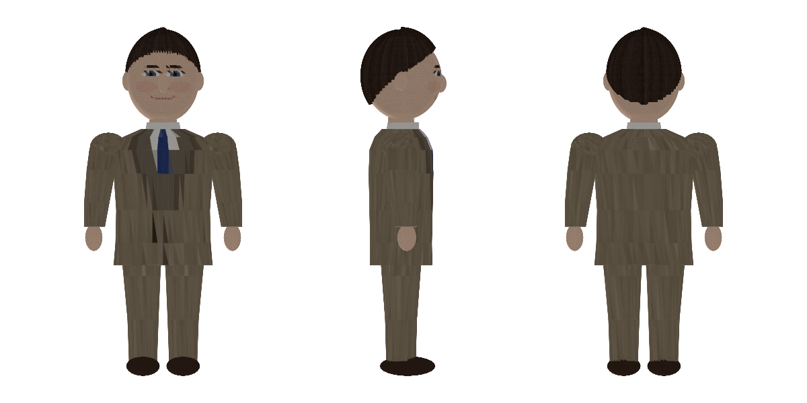

# 앨런 튜링 3D 모델

로블록스 튜링 NPC를 더 실감 나게 바꾸고 싶을 때 쓰는 3D 모델입니다. (기본 NPC는 블록으로 만든 튜링입니다.)

| 항목 | 값 |
| --- | --- |
| 파일 | `turing_3D_Model.zip` (OBJ + MTL + 텍스처 4장) |
| 크기 | 높이 1.0, 발바닥 y=0, 정면 +z 방향 |
| 면 수 | 약 1.9만 개 (Roblox 메시 한도 2만 개 이하) |
| 차림 | 짙은 갈색 머리(옆 가르마), 트위드 스리피스 정장, 흰 셔츠, 파란 넥타이 |

> 미리보기는 간이 렌더라 얼굴이 각져 보입니다. 3D 프로그램이나 Roblox에서는 텍스처가 매끈하게 보입니다.

## Roblox에 넣는 방법

1. ZIP 압축을 풉니다.
2. Roblox Studio에서 **3D 가져오기(Import 3D)** → `turing_3D_Model.obj`를 선택합니다.
3. 가져온 모델의 크기를 맞추고 이름을 **`Turing`**으로 바꿉니다. 채팅 스크립트가 이 이름의 모델에서 `Head`를 찾아 말풍선을 띄웁니다.
4. 기본 블록 NPC(`Turing`)를 지우고 같은 자리에 놓습니다.

머리 위에 말풍선이 뜨려면 모델 안에 `Head`라는 이름의 파트가 있어야 합니다. 메시 하나로 가져온 경우, 얼굴 높이에 투명한 파트를 하나 만들어 이름을 `Head`로 지정하세요.
